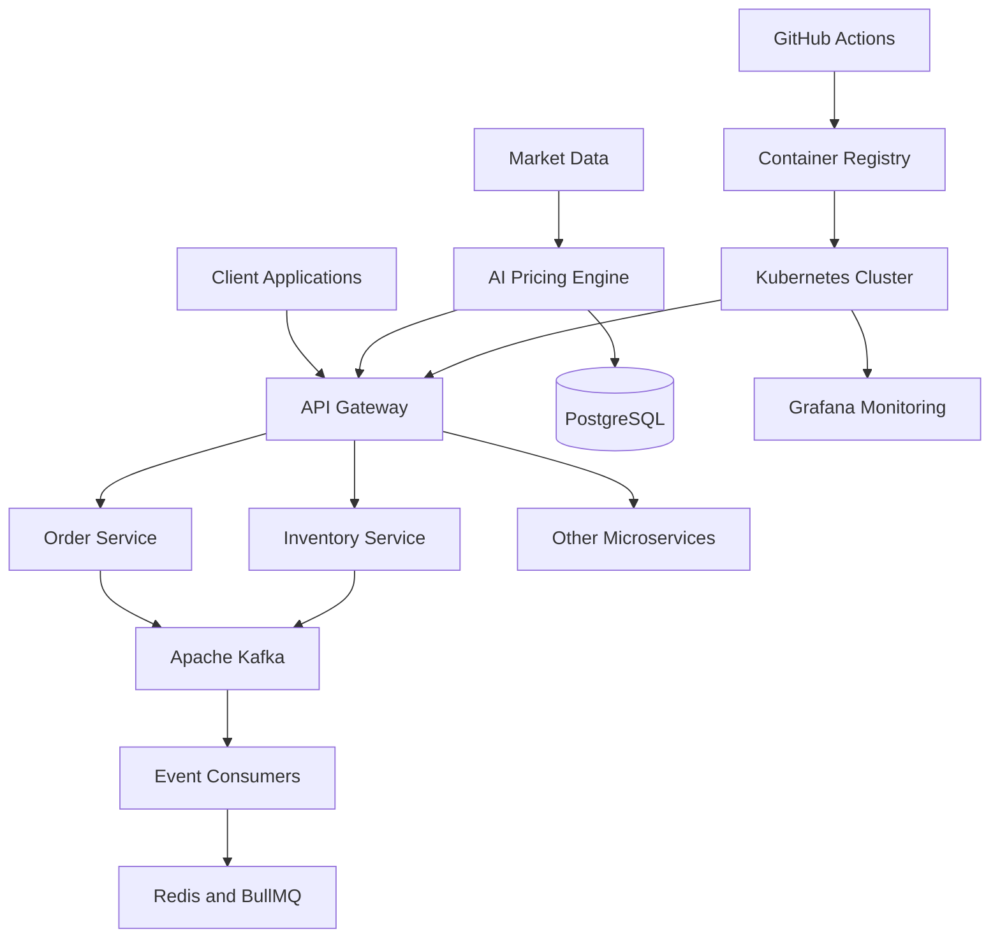

# CartCraft 🛒
### Distributed Microservices E-Commerce Platform

CartCraft is a containerized, microservices-based e-commerce platform designed for scalability, reliability, and independent service deployment. It combines API Gateway routing, event-driven communication, asynchronous background processing, AI-assisted dynamic pricing, and automated CI/CD workflows.

## 🚀 Key Features

### 1. Distributed Microservices Architecture
- Designed an 8-service e-commerce architecture.
- API Gateway for centralized routing and service isolation.
- Independent service deployment for scalability and maintainability.

### 2. Event-Driven Order and Inventory Management
- Apache Kafka for asynchronous, event-driven communication.
- Redis and BullMQ for background jobs and task processing.
- Order processing and inventory reservation workflows.
- Grafana dashboards and metrics for service observability.

### 3. AI-Assisted Dynamic Pricing Engine
- LangGraph-based market analysis and pricing strategy generation.
- Demand scoring and deterministic pricing safeguards.
- PostgreSQL-backed workflow state.
- Human approval before executing proposed prices through microservice APIs.

### 4. Deployment and CI/CD Automation
- Docker-based application containerization.
- Kubernetes for microservices orchestration.
- NGINX Ingress for service routing and external access.
- cert-manager for TLS certificate management.
- GitHub Actions for automated builds, image publishing, and Kubernetes deployments.

## 🛠️ Technology Stack

| Category | Technologies |
|---|---|
| Backend | Node.js, JavaScript |
| AI and Workflow Orchestration | Python, LangGraph |
| Messaging | Apache Kafka |
| Background Jobs | Redis, BullMQ |
| Database | PostgreSQL |
| API Routing | API Gateway, NGINX |
| Containerization | Docker |
| Orchestration | Kubernetes |
| CI/CD | GitHub Actions |
| Monitoring | Grafana |
| Security | TLS, cert-manager |

## 🏗️ System Architecture



> Note: Update the diagram to reflect the actual services and integrations implemented in your repository.

## 📋 Prerequisites

Before running the project, install:

- Node.js and npm
- Python
- Docker and Docker Compose
- PostgreSQL
- Redis
- Apache Kafka
- Kubernetes and kubectl (for Kubernetes deployment)

## ⚙️ Getting Started

### 1. Clone the Repository

```bash
git clone <YOUR_GITHUB_REPOSITORY_URL>
cd CartCraft
```

### 2. Install Dependencies

Navigate to the required service directory and install its dependencies.

```bash
cd <SERVICE_DIRECTORY>
npm install
```

For Python services, install dependencies using the project's requirements.txt or pyproject.toml file.

### 3. Configure Environment Variables

Create a `.env` file using the variables required by your application.

```env
PORT=
DATABASE_URL=
REDIS_URL=
KAFKA_BROKERS=
JWT_SECRET=
AI_PROVIDER_API_KEY=
```

Use the actual environment variable names expected by your services. Never commit real credentials or API keys.

### 4. Start the Application

Start the required infrastructure and application services using the Docker Compose configuration or the startup commands provided in the repository.

Example:

```bash
docker compose up --build
```

This command works only if your repository contains a correctly configured `compose.yaml` or `docker-compose.yml` file.

## 🚢 Deployment and CI/CD

The deployment workflow can include:

1. Build Docker images for application services.
2. Push images to a container registry.
3. Deploy updated services to Kubernetes.
4. Configure NGINX Ingress for external routing.
5. Configure TLS using cert-manager.
6. Monitor application health and metrics using Grafana.

GitHub Actions can automate these stages through a CI/CD pipeline.

## 🧠 Engineering Concepts Demonstrated

- Microservices architecture
- Distributed systems
- API Gateway and service isolation
- Event-driven architecture
- Message brokers and asynchronous processing
- Background job queues
- Database-backed workflow state
- AI-assisted pricing and human approval
- Docker and Kubernetes
- CI/CD automation
- Monitoring and secure service communication

## 🔮 Future Improvements

- Distributed tracing with OpenTelemetry
- Centralized logging and alerting
- Automated integration and end-to-end testing
- Dead-letter queues and idempotent event consumers
- Circuit breakers and retry policies
- Horizontal autoscaling and performance benchmarking
- Enhanced authentication and secrets management

## 👨‍💻 Author

**Bhuyan Bhaskar Deo**

National Institute of Technology Jamshedpur

B.Tech — Electronics and Communication Engineering

## 📄 License

Add an appropriate open-source license if you intend to distribute the project publicly.
```
